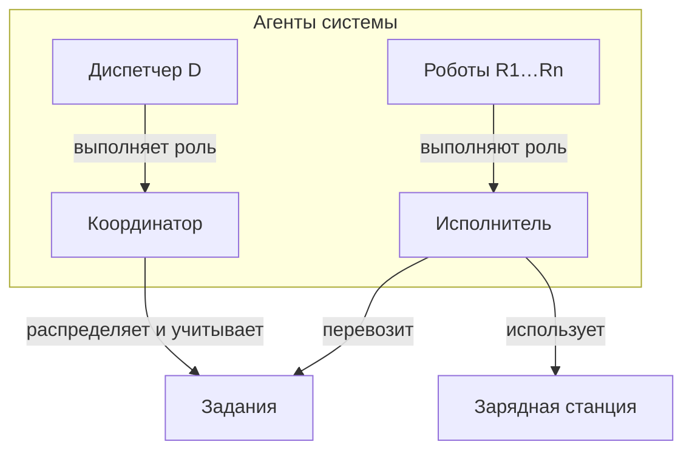
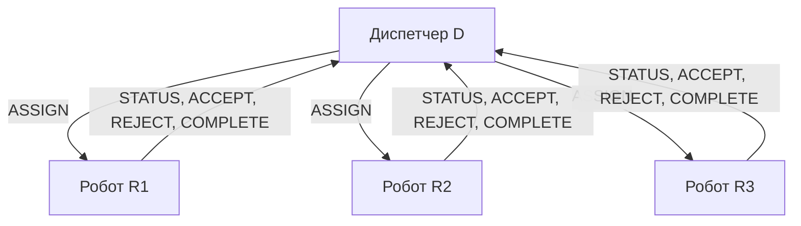
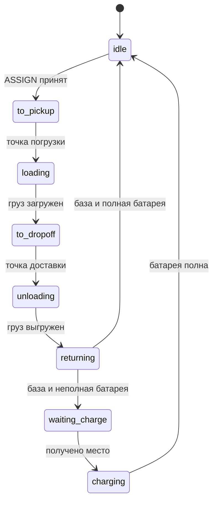
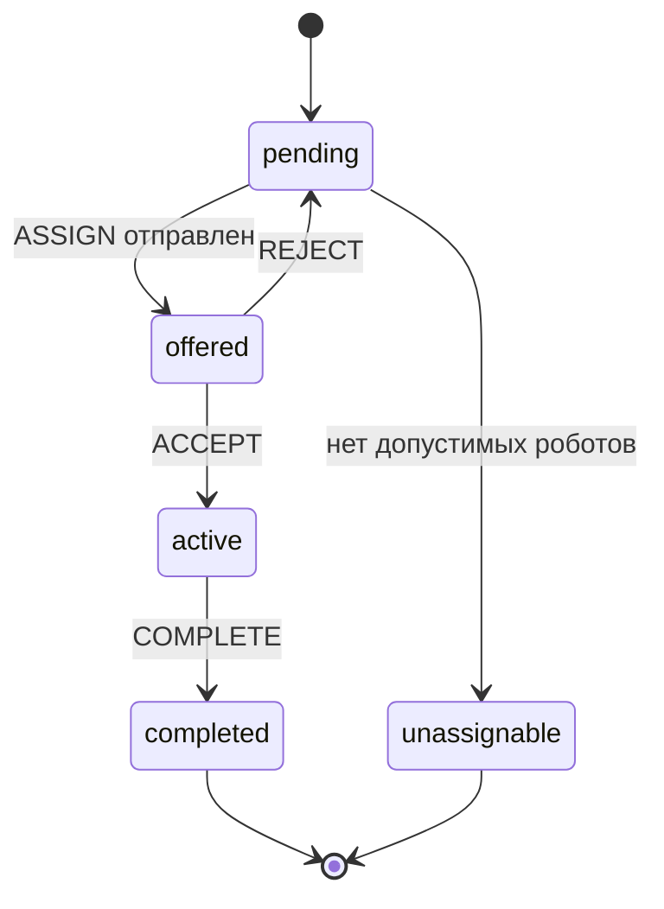

# Диаграммы ЛР1

Диаграммы ролей и коммуникаций включены также в [отчёт](REPORT_LR1.md).
Этот файл содержит их вместе с дополнительным автоматом состояний робота.

## Роли

Зарядная станция — общий инструмент среды, не агент. Шина и планировщик также не имеют агентных ролей.

## Направленный граф коммуникаций

Для n роботов дуги D → Rᵢ и Rᵢ → D повторяются для каждого i.
Все агентные сообщения проходят через одну логическую шину с задержкой в один такт.
Прямых сообщений робот → робот в этой версии нет.

## Автомат состояний робота

Отказ от назначения сохраняет текущее состояние. В `waiting_charge` робот повторяет
запрос места; в `charging` пополняет энергию до полного заряда. При возвращении
отправляет `COMPLETE`, при смене состояния — `STATUS`.

## Жизненный цикл задания

Из `pending` переходы разрешены только после момента поступления.
