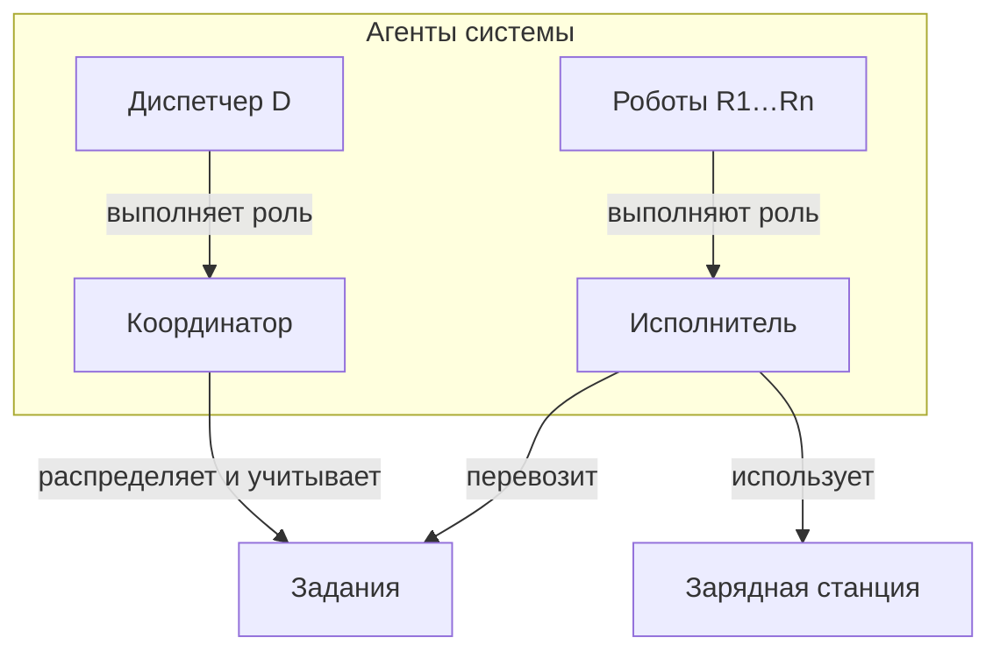
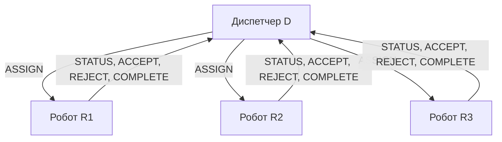

# Лабораторная работа №1

## Спецификация и архитектурное проектирование многоагентной системы

Предмет: «Теория многоагентных систем».

### 1. Цель работы

Выбрать прикладную задачу, формально описать многоагентную систему, построить диаграмму ролей
и граф коммуникаций, обосновать архитектуру. Разработать минимальный прототип для проверки
спецификации и демонстрации взаимодействий. Основой задания служат рекомендации
«Лабораторные-МАС.pdf».

Теоретическая основа: лекции 1–3 о свойствах МАС, формальных моделях, архитектурах
и ролях; лекция 4 о диспетчеризации и коммуникациях. Лекции 5–6 использованы для
проверки возможности продолжения проекта в ЛР3–ЛР4. Номера страниц источников
и соответствие требованиям приведены в [сверке с лекциями](LECTURE_ALIGNMENT.md).

### 2. Прикладная задача

На складе работает несколько роботов с разной грузоподъёмностью и ёмкостью аккумулятора.
Поступают задания на перевозку груза из точки погрузки в точку доставки. Необходимо назначать
допустимых исполнителей, доставлять грузы, учитывать заряд и общий ограниченный ресурс —
зарядную станцию.

Целевое поведение: каждое допустимое задание выполняется один раз; невыполнимые задания
явно выделяются; ограничения массы, энергии и зарядных мест соблюдаются. Глобальная
оптимальность расписания в ЛР1 не требуется и не гарантируется.

Приняты следующие ограничения модели:

- Пространство — прямоугольная целочисленная сетка без препятствий.
- Допускается совместное нахождение роботов в клетке; предотвращение столкновений не моделируется.
- Общая база и зарядная станция находятся в одной точке. Все роботы изначально на базе и заряжены.
- Робот выполняет один рейс: база → погрузка → доставка → база. Новое задание принимает после полной зарядки.
- За такт робот перемещается на одну клетку по одной оси. Сначала изменяет координату x, затем y.
- Погрузка и разгрузка занимают по одному отдельному такту.
- Если точка назначения текущего участка совпадает с позицией, переход к следующему состоянию всё равно занимает такт.
- Движение на клетку расходует единицу энергии; ожидание, погрузка, разгрузка и связь её не расходуют.
- Срок доставки мягкий: его нарушение регистрируется, но не отменяет перевозку.
- Агентов исполняет один процесс с детерминированным порядком; физическая параллельность не предполагается.

Различаются доставка груза и завершение рейса. Доставка фиксируется при разгрузке.
Завершение задания диспетчером фиксируется после возвращения робота и получения `COMPLETE`.
Зарядка после рейса относится к подготовке робота к следующему заданию.

### 3. Формальная модель среды и заданий

Склад задаётся множеством клеток

$$
V=\{(x,y)\mid 0\leq x<W,\;0\leq y<H,\;x,y\in\mathbb Z\}.
$$

Расстояние между клетками — манхэттенское:

$$
d(a,b)=|a_x-b_x|+|a_y-b_y|.
$$

Пусть h — точка базы. Задание описывается кортежем

$$
q=(id,p_q,d_q,w_q,r_q,\pi_q,\delta_q),
$$

где p — точка погрузки, d — точка доставки, w — масса, r — такт поступления,
π — приоритет (большее значение выше), δ — необязательный срок доставки.
Идентификаторы заданий уникальны; масса положительна; время и приоритет неотрицательны.

Для робота i заданы грузоподъёмность Cᵢ и ёмкость аккумулятора Bᵢ.
Длина полного рейса:

$$
L(q)=d(h,p_q)+d(p_q,d_q)+d(d_q,h).
$$

При резерве энергии ε задание допустимо для робота, если

$$
w_q\leq C_i\quad\land\quad L(q)+\varepsilon\leq B_i.
$$

Каждое принятое задание начинается с полной батареей на базе, поэтому эта проверка
покрывает весь рейс и возвращение. Нельзя проверять только путь до доставки.
Если ни один робот не проходит оба условия, задание получает терминальный статус
`unassignable` с причиной. Этот статус не считается успешным выполнением.

Зарядная станция задаётся числом мест K ≥ 1, скоростью зарядки v ≥ 1,
множеством владельцев мест и очередью ожидания FIFO.

#### 3.1. Классификация среды

| Свойство | Выбранная модель |
|---|---|
| Дискретность | Целочисленные координаты, энергия и такты |
| Детерминированность | Одинаковые входные данные и порядок агентов дают одинаковую трассу |
| Последовательность | Перевозка меняет заряд и доступность робота для следующих заданий |
| Динамичность | По тактам поступают задания, движутся другие роботы, меняется очередь зарядки |
| Наблюдаемость | Частичная для агента: робот знает своё состояние, диспетчер получает задержанные статусы |

Приостановка между тактами нужна для демонстрации. Она не делает склад статической
или эпизодической средой. Частичная наблюдаемость здесь задана ограничением информации;
вероятностный POMDP и обучение с подкреплением в прототипе не реализованы.

#### 3.2. Локальное и глобальное состояние

Следуя лекции 2, отделяем состояние среды от памяти агентов. Постоянные параметры
карты, сценария и роботов считаются фиксированными входными данными.

Состояние среды `e` содержит текущий такт, владельцев и очередь зарядной станции,
сообщения в пути и входящих очередях, счётчик сообщений. Состояние диспетчера `i_D`
содержит реестр заданий с назначениями, последние полученные статусы роботов
и множество уже поступивших заданий. Состояние робота `i_k` содержит позицию,
энергию, фазу рейса, принятое задание, последний опубликованный статус и счётчики
пути и ожидания. Позиция и энергия отнесены к локальному состоянию робота и
повторно в `e` не включаются.

Глобальное состояние и пространство состояний:

$$
s_t=(e_t,i_{D,t},i_{1,t},\ldots,i_{n,t}),\qquad
S_{global}=S_{env}\times I_D\times\prod_{k=1}^{n}I_k.
$$

Наблюдение агента — проекция доступной ему информации:

$$
o_{a,t}=\nu_a(s_t).
$$

Диспетчер видит время, исходные задания и характеристики роботов, собственный реестр
и сообщения, доставленные на его адрес. Будущие задания известны из сценария,
но не допускаются к назначению до `release`.

Робот видит собственное состояние, свою грузоподъёмность и батарею, правила базы,
доставленное ему назначение и ответ станции на запрос места. Полный сценарий,
список остальных заданий и характеристики других роботов ему не передаются.
Это разделение данных в программной модели, а не защищённая изоляция процессов:
транспорт, станция и журнал остаются общими объектами одного процесса.

#### 3.3. Переход системы и история

Для фиксированного сценария переход детерминирован:

$$
s_{t+1}=F(s_t).
$$

`F` последовательно доставляет сообщения с `deliver_at <= t`, выполняет шаг
диспетчера, затем шаг каждого робота в порядке идентификаторов. Отправка сообщения
добавляет его в транспорт с `deliver_at = t+1`; назначение резервирует робота;
перемещение меняет координату и уменьшает заряд на единицу; зарядка увеличивает
его до ёмкости батареи. Остальные переходы перечислены в разделах 5 и 8.
Порядок обращений к общему ресурсу входит в определение `F` и обеспечивает
однозначность результата при одновременных запросах.

Теоретическая история системы — последовательность глобальных состояний и действий,
локальная история — наблюдений и действий конкретного агента. В реализации
`trace.jsonl` хранит события отправки/доставки сообщений, действия и снимки после такта.
Это журнал для анализа истории, а не полная сериализация внутренней памяти:
снимок не содержит все входящие очереди и служебные поля. Возобновление исполнения
из произвольного снимка в ЛР1 не реализовано; повторный запуск идёт из `scenario.json`.

### 4. Агенты и роли

Множество агентов:

$$
A=\{D,R_1,\ldots,R_n\},\quad n\geq1.
$$

Каждый агент описывается набором «роль, цель, знания, состояние, действия, полномочия, средства».
Зарядная станция, шина сообщений и планировщик тактов — элементы среды, а не агенты:
у них нет собственной цели и выбора поведения.

| Характеристика | Диспетчер D | Робот Rᵢ |
|---|---|---|
| Роль | Координатор перевозок | Автономный исполнитель |
| Цель | Назначать допустимые задания и учитывать результат | Выполнять принятый рейс с соблюдением ограничений и восстанавливать готовность |
| Знания | Все задания сценария, характеристики роботов, база, резерв энергии, последние полученные статусы | Собственные характеристики, позиция, заряд, текущее задание, база, состояние запросов к зарядной станции |
| Локальное состояние | Реестр заданий, назначения, статусы готовности, множество поступивших заданий | Позиция, энергия, состояние автомата, текущее задание |
| Действия | Ввод задания в работу, проверка допустимости, выбор исполнителя, отправка назначения, обработка ответа и результата | Проверка и принятие/отказ, движение, погрузка, разгрузка, возвращение, запрос зарядного места, зарядка, отправка статуса и результата |
| Полномочия | Менять реестр заданий и предлагать назначение; не менять внутреннее состояние робота | Менять своё состояние и запрашивать ресурс; не назначать задания другим роботам и не менять реестр диспетчера |
| Средства | Очередь сообщений, стратегия выбора, реестр заданий | Локальный маршрут, условные привод и захват, аккумулятор, API зарядной станции, очередь сообщений |

Термин «автономный» означает наличие локальной проверки и собственного автомата действий.
Робот не является полностью независимым планировщиком склада: новые задания выдаёт диспетчер.

#### 4.1. Формальная модель отдельного агента

Используется модель агента с внутренним состоянием из лекции 2:

$$
Ag_a=\langle I_a,see_a,next_a,action_a\rangle.
$$

Здесь `I_a` — множество состояний памяти, `see_a` — получение доступного наблюдения,
`next_a` — обновление памяти по наблюдению, `action_a` — выбор действий на основе памяти.
В реализации это логические части метода `step`, а не четыре отдельных класса.
Действие за такт может быть упорядоченным набором операций: например, принять
назначение, отправить `ACCEPT`, сделать шаг движения и опубликовать статус.

| Компонент | Диспетчер | Робот |
|---|---|---|
| `see` | Входящие сообщения и наступление момента `release` | Входящее назначение, собственная позиция/энергия и ответ станции |
| `next` | Обновить статусы, назначения и реестр по ответам | Запомнить принятое задание и обновить фазу автомата |
| `action` | Отсортировать очередь, выбрать допустимого свободного робота, отправить `ASSIGN` либо ждать | Принять/отклонить, двигаться, грузить, разгружать, возвращаться, ждать или заряжаться |
| Цель | Учесть результат каждого поступившего задания без повторных назначений | Доставить принятый груз, вернуться и восстановить готовность |
| Ограничения | Не назначать до `release`, не резервировать два рейса одному роботу | Соблюдать массу, энергию, фазу рейса и право на зарядное место |

Политика диспетчера явно задана сортировкой и выбором в разделе 9. Политика робота
явно задана проверками `_assignment` и ветвями автомата `step`. Цели направляют
эти правила; отдельная функция награды и оптимизация политики обучением отсутствуют.

#### 4.2. Роль и программная реализация

Роль «координатор» означает обязанность распределять и учитывать перевозки,
а роль «исполнитель» — проверять и выполнять принятый рейс с отчётом.
Класс `Dispatcher` реализует первую роль; каждый экземпляр класса `Robot` — вторую.
Три экземпляра одного класса означают три агента с разными состояниями, а не три роли.

Для координатора нужны компетенции проверки ограничений и выбора исполнителя;
для исполнителя — расчёт длины рейса, перемещение и управление зарядкой.
Форма поведения задана протоколом структурированных сообщений и фиксированными
правилами; текстовая персона и системный промпт для этой реализации не требуются.

### 5. Состояния и инварианты

Состояния задания:

| Состояние | Значение | Основной переход |
|---|---|---|
| `pending` | Ожидает поступления или назначения | `offered` при отправке предложения; `unassignable` при отсутствии допустимого робота |
| `offered` | Назначение отправлено, робот зарезервирован | `active` после `ACCEPT`; `pending` после `REJECT` |
| `active` | Робот подтвердил рейс | `completed` после `COMPLETE` от назначенного робота |
| `completed` | Рейс завершён | Терминальное состояние |
| `unassignable` | Нет допустимого исполнителя при полных батареях | Терминальное состояние |

До такта r задание присутствует в исходном реестре, но не участвует в назначении.

Состояния робота: `idle`, `to_pickup`, `loading`, `to_dropoff`, `unloading`,
`returning`, `waiting_charge`, `charging`.

Инварианты:

1. У задания не более одного назначенного исполнителя.
2. У робота не более одного задания в статусе `offered` или `active`.
3. Назначение не выполняется до поступления задания.
4. Масса принятого груза не превышает грузоподъёмность.
5. Энергия лежит в диапазоне от 0 до Bᵢ; позиция принадлежит V.
6. `idle` означает нахождение на базе с полной батареей.
7. Зарядных мест одновременно занято не больше K.
8. Диспетчер принимает результат только для активного задания от назначенного исполнителя.

Часть инвариантов проверяется после каждого такта; остальные обеспечиваются проверками
при назначении, обработке сообщений и переходах, а также автоматическими тестами.

### 6. Диаграмма ролей

Каждый робот играет одну роль исполнителя, диспетчер — одну роль координатора.
Связи этой диаграммы показывают роли и обязанности, а не передачу сообщений.

### 7. Граф коммуникаций и каналы

В демонстрационном сценарии три робота. Для произвольного n граф содержит дуги
D → Rᵢ и Rᵢ → D для каждого i. Прямого обмена между роботами в ЛР1 нет.

Формально:

$$
G_{comm}=(A,E),\qquad
E=\{(D,R_i),(R_i,D)\mid 1\leq i\leq n\}.
$$

Это статическая ориентированная звезда с `n+1` вершинами и `2n` дугами.
Топология сильно связна: путь между любыми роботами проходит через диспетчера.
При этом текущий протокол не пересылает произвольные сообщения от робота к роботу;
наличие пути в графе не означает реализованный протокол ретрансляции.

Канал реализован шиной сообщений в памяти процесса. Сообщение, отправленное на такте t,
доступно получателю на такте t+1. Доставка надёжная, без потерь и дублирования;
порядок сообщений сохраняется по порядку отправки. Внутрипроцессный транспорт не предоставляет
криптографической аутентификации и не моделирует враждебного отправителя.

Запрос и освобождение зарядного места — синхронные операции со средой, они не входят
в граф агентных сообщений и счётчик сообщений. Их последствия видны в трассе состояний,
очереди и владельцев ресурса.

### 8. Формат и протокол сообщений

Оболочка сообщения: порядковый номер, такт отправки, такт доставки, отправитель,
получатель, тип, необязательный идентификатор задания, тело.

| Тип | Направление | Данные и смысл |
|---|---|---|
| `STATUS` | Робот → диспетчер | Состояние, заряд и позиция на момент отправки; начальный статус и последующие изменения состояния |
| `ASSIGN` | Диспетчер → робот | Идентификатор и полное описание задания |
| `ACCEPT` | Робот → диспетчер | Подтверждение после локальной проверки |
| `REJECT` | Робот → диспетчер | Отказ с причиной: занят, неверное задание, ограничения, неготовность |
| `COMPLETE` | Робот → диспетчер | Завершение рейса после возвращения на базу |

Последовательность взаимодействия:

1. Робот публикует начальный `STATUS`.
2. Диспетчер вводит поступившие задания в работу и проверяет их допустимость.
3. Для свободного подходящего робота фиксирует `offered`, резервирует исполнителя и отправляет `ASSIGN`.
4. Робот независимо проверяет задание и собственную готовность. При успехе отправляет `ACCEPT`
   и начинает рейс, при отказе отправляет `REJECT` без выполнения перевозки.
5. Диспетчер переводит подтверждённое задание в `active`. После отказа возвращает его в `pending`;
   дальнейший выбор требует статуса робота.
6. Робот последовательно перемещается, загружает, доставляет, разгружает и возвращается.
7. После возвращения отправляет `COMPLETE`. Диспетчер фиксирует `completed` только от назначенного робота.
8. Робот ждёт зарядного места, заряжается и сообщает `idle` после восстановления батареи.

Новый статус передаётся при изменении состояния, а не на каждом шаге движения.
Поэтому данные о промежуточной позиции и заряде у диспетчера могут отставать.
Алгоритм использует только готовность `idle`; в этом состоянии позиция и заряд известны точно.

Транспортная задержка важна: резервирование происходит при отправке предложения,
поэтому до получения `ACCEPT` робот не может получить второе назначение.

### 9. Алгоритм распределения и поведение ресурса

Поступившие ожидающие задания сортируются по убыванию приоритета, затем по возрастанию
момента поступления, затем лексикографически по идентификатору. Среди свободных допустимых
роботов выбирается робот с минимальным избытком грузоподъёмности Cᵢ − w_q;
равенство разрешается по идентификатору робота. Это позволяет сохранять более
грузоподъёмных исполнителей для тяжёлых грузов, но не доказывает оптимальность расписания.

На зарядной станции действует обычная очередь FIFO. Повторный запрос не дублирует участника.
Если робот стоит первым и есть место, он получает его. Зарядка увеличивает энергию на v
за такт до Bᵢ, после чего место освобождается. Переход от ожидания к зарядке занимает
отдельный такт; на этом такте энергия ещё не увеличивается.
При одновременном обращении порядок определяется обходом роботов по идентификаторам.
Это техническое правило для воспроизводимости, а не исследованный механизм справедливости.

### 10. Архитектура и её обоснование

Выбрана иерархическая многоагентная архитектура с централизованной координацией
и автономными исполнителями. Реестр заданий принадлежит диспетчеру, состояние каждого
робота принадлежит самому роботу. Агенты получают изменения друг от друга через сообщения.
Планировщик лишь доставляет сообщения и вызывает действия агентов по тактам;
он не выбирает назначения и не перемещает роботов вместо них.

Следует различать два уровня архитектуры из лекций 1 и 3:

- **Организация МАС:** иерархия «координатор — исполнители», централизованное
  распределение заданий и локальное управление рейсом.
- **Устройство агента:** детерминированные правила с внутренней памятью.
  Робот — конечный автомат, диспетчер — агент с реестром и явной эвристикой выбора.

Таких роботов можно отнести к активным агентам с внутренним состоянием в классификации
лекции 1. Их поведение ограничено заданными правилами: они не обучаются и не строят
альтернативные планы. Иерархическая организация системы сама по себе не означает
гибридную архитектуру отдельного агента. Полноценные BDI, механизм логического вывода
и слои когнитивного планирования/реактивного управления в этой версии не реализованы.

Такая архитектура подходит для небольшой складской модели: диспетчер явно управляет
единственностью назначения, а робот локально контролирует допустимость действий.
Разделение реестра, состояния робота, транспорта, общего ресурса и стратегии позволяет
изменять механизм координации без переписывания движения и учёта энергии.

Альтернативы:

| Архитектура | Особенности для выбранной задачи |
|---|---|
| Полностью централизованный контроллер | Проще, но локальные решения и отказ исполнителя было бы труднее выделить как агентное поведение |
| Полностью распределённая МАС | Подходит для последующего сравнения, но требует согласования владения заданиями и дополнительных сообщений |
| Выбранная иерархическая МАС | Даёт явный протокол, локальную автономию и компактную основу для четырёх работ |

Ограничения: диспетчер является единой точкой координации и потенциальной точкой отказа;
масштабирование и потеря связи пока не исследованы. Общая база и обязательная полная зарядка
упрощают ограничения энергии ценой неэффективных возвратов. Сетевой транспорт и модель
столкновений отсутствуют. Приоритеты и детерминированные равенства могут давать неравномерную
нагрузку. Эти ограничения явно отделены от заявленных свойств прототипа.

### 11. Реализация и проверка спецификации

Прототип написан на Python 3.11+ без сторонних библиотек МАС. Реализованы собственные агенты,
шина сообщений, алгоритм распределения, автоматы состояний и управление зарядным ресурсом.
Каждый такт выполняется в порядке: доставка сообщений → шаг диспетчера → шаги роботов →
проверка инвариантов → снимок состояния.

Выполнение завершается, когда все задания терминальны, роботы полностью готовы на базе,
а отправленные сообщения доставлены. Предельное число тактов ограничивает запуск;
достижение лимита не считается успешным завершением и не меняет оставшиеся задания на выполненные.

Подготовлены четыре сценария и 23 автоматические проверки. Проверки охватывают маршрут и возврат,
границу энергетической допустимости, массу, приоритеты, поступление, зарядную очередь,
единственность доставки, локальный отказ робота, задержку сообщений, воспроизводимость,
экспорт и запуск интерфейса. Все 23 проверки прошли на Python 3.12.14.
GitHub Actions также успешно выполнил все проверки на Python 3.11, 3.12 и 3.13
для реализации в коммите `dd482f4`.

Результат подтверждает согласованность прототипа с принятой спецификацией на проверенных
сценариях. Это не экспериментальное сравнение механизмов и не доказательство устойчивости к атакам.

#### 11.1. Показатели качества

В терминах лекции 2 выделены глобальные и локальные показатели. Они вычисляются
по состояниям и трассе; число тактов модели не является временем работы Python.

| Уровень | Показатель | Поле результата и смысл |
|---|---|---|
| Глобальный | Результативность | `tasks_completed`, `tasks_unassignable`, `tasks_unfinished` учитываются отдельно |
| Глобальный | Время | `ticks` включает финальную готовность и доставку статусов; `mission_makespan` — такт последнего полученного `COMPLETE` |
| Глобальный | Коммуникации | `messages_sent`, `messages_by_kind` — отправленные сообщения агентного протокола |
| Глобальный | Расход движения | `distance` — сумма перемещений всех роботов, включая возвращение |
| Глобальный | Дефицит зарядки | `charge_wait_ticks` — сумма тактов неуспешного ожидания всех роботов |
| Локальный, робот | Затраты исполнителя | `robots[].distance`, `robots[].charge_wait_ticks`, текущая батарея |
| Задание | Соблюдение срока | `delivery_tardiness = max(0, delivered_at - deadline)` при наличии доставки и срока |

Для конечного сценария целевое состояние — терминальный результат всех заданий,
готовность всех роботов на базе и отсутствие сообщений в пути. Значение `unassignable`
означает обработанный отказ, а не достижение цели доставки этого груза.
При сравнении механизмов в ЛР2 потребуется сопоставлять успешность, время и стоимость
коммуникаций на одинаковых входных данных. Текущая эвристика не минимизирует все
эти показатели одновременно; измерение метрик не доказывает оптимальность.

### 12. Возможность продолжения

Для ЛР2 выделен интерфейс распределения и собираются показатели времени, пути, очереди
и сообщений. Второй механизм нужно реализовать и сравнить на одинаковых сценариях.
Контрактная сеть потребует дополнительных сообщений предложений и ставок.

Для ЛР3 уже существует ограниченный ресурс зарядки. На его основе можно ввести переговоры,
арбитраж или изменение правил приоритета и сравнить эффективность и справедливость.
Текущая очередь FIFO служит исходным поведением для такого сравнения.

Для ЛР4 есть журнал действий и сообщений, инварианты и ограничение времени моделирования.
Следует добавить сценарии потери связи, ложных статусов или отказа ресурса, затем защитные
механизмы и повторную оценку. В текущем прототипе такие испытания не выполнены.

### 13. Вывод

Спроектирована МАС для складских перевозок. Определены агенты, роли, цели, знания,
состояния, полномочия и средства. Построены диаграмма ролей и направленный граф коммуникаций,
описаны сообщения и взаимодействие. Обоснована архитектура с диспетчером и автономными роботами.
Разработан проверяемый прототип, сохраняющий трассы и допускающий развитие для следующих работ.

### Приложения

- [Соответствие заданию и лекциям](LECTURE_ALIGNMENT.md).
- [Исходные коды](https://github.com/nndbnb/TMS_project/tree/main/warehouse).
- [План реализации](PLAN_LR1.md).
- [Демонстрация и контрольные результаты](DEMO.md).
- [Сценарии](https://github.com/nndbnb/TMS_project/tree/main/scenarios).
- [Автоматические проверки](https://github.com/nndbnb/TMS_project/tree/main/tests).
